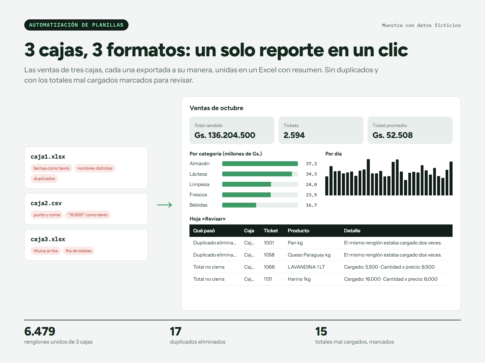

# Ventas de 3 cajas en un reporte de un clic

[](https://github.com/nandres/ventas-consolidadas-excel/actions/workflows/ci.yml)

Muestra de trabajo con **datos ficticios**. Une las exportaciones de tres cajas, cada una con su propio formato, en un solo Excel con resumen.



## Qué resuelve

- **Reconoce cada formato:** fechas como texto, punto y coma, títulos arriba, filas de totales y montos escritos como texto.
- **Normaliza los productos** contra `catalogo.csv`, aunque cada caja los nombre distinto.
- **Elimina los duplicados** y lo deja anotado.
- **Marca los totales mal cargados** en una hoja «Revisar», sin cambiarlos por su cuenta.

## Correrlo

Requiere Python 3.11 o superior.

```bash
pip install -r requirements.txt
python consolidar.py
```

En Windows también se puede abrir `consolidar.bat` con doble clic.

| Carpeta o archivo | Para qué sirve |
|---|---|
| `entrada/` | Los archivos de cada caja |
| `salida/` | El reporte final |
| `catalogo.csv` | Los nombres correctos de los productos |
| `generar_datos.py` | Crea los datos de ejemplo |

El CI corre el script completo y abre el Excel que genera.

## Licencia

Software propietario: ver [LICENSE](LICENSE).

Hecho por **Marcos Arellano** · [marcos-arellano.vercel.app](https://marcos-arellano.vercel.app)
